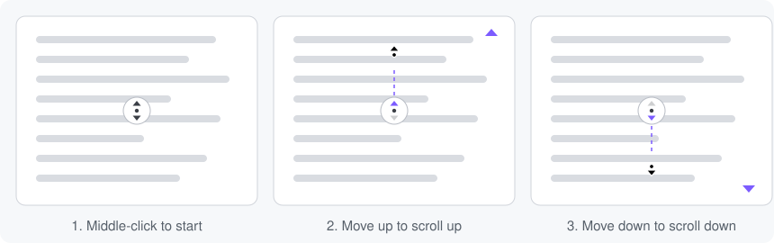

# Middle Click Autoscroll

Middle-click autoscrolling for Obsidian, the way it works in Chrome and Firefox.

## Usage



- Middle-click inside a note. An indicator appears where you clicked.
- Move the mouse up or down to scroll. The further from the indicator, the faster it goes.
- Stop with another middle-click, `Esc`, any other mouse button, or the scroll wheel.
- Or hold the middle button, drag, and release to stop.

Works in Live Preview, Source mode and Reading view, including embeds and hover previews. Middle-clicking a link still opens it in a new tab.

Desktop only. You need a mouse with a middle button (or a trackpad tool that sends one).

## Install

**From Obsidian:** Settings → Community plugins → Browse, search for "Middle Click Autoscroll", then Install and Enable.

**Manually:**

1. Download `main.js`, `manifest.json` and `styles.css` from the [latest release](https://github.com/spunch-bop-88/obsidian-middle-click-autoscroll/releases/latest).
2. Put them in `<your vault>/.obsidian/plugins/middle-click-autoscroll/`.
3. In Obsidian, reload Community plugins and enable Middle Click Autoscroll.

## Settings

| Setting | Default | |
| --- | --- | --- |
| Maximum speed | 3000 px/s | Top scroll speed |
| Sensitivity | 1.0 | How fast speed grows with distance |
| Dead zone | 12 px | Radius around the start point with no scrolling |
| Show indicator | On | Draw the indicator at the start point |
| Live Preview | On | Enable in Live Preview |
| Source mode | On | Enable in Source mode |
| Reading view | On | Enable in Reading view |
| Middle-click on links opens them | On | Don't start autoscroll on links |

## Development

```bash
npm install
npm run dev     # rebuild main.js on save
npm run build   # type-check and build for release
```

To test, put this folder (or the three built files) in `<vault>/.obsidian/plugins/middle-click-autoscroll/` and reload the plugin.

Releases: bump `version` in `manifest.json`, `package.json` and `versions.json`, then push a tag with the same version (no `v` prefix). The workflow creates a draft release with the built files.

## License

[MIT](LICENSE)
